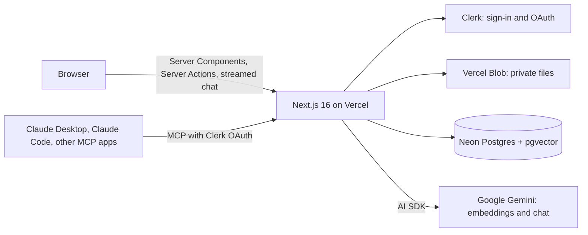
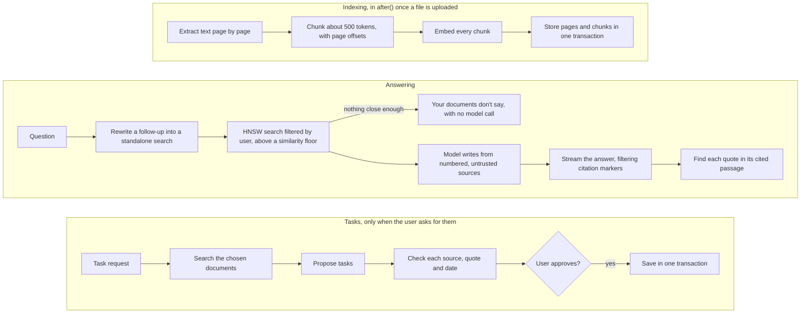

# DocChat


Upload your documents, ask questions in plain language, and get answers that cite the exact
sentence they came from, so you can check them instead of trusting them.

**[Live app](https://docchat.raheem.online)** · Demo video:

https://github.com/user-attachments/assets/b3fe4c3a-09d3-467a-a525-8d5982cb59f5

.

[Build thread on X](https://x.com/Walett25)
· [Portfolio](https://raheem.online)

<!-- TODO(demo-video): replace "Demo video: coming soon" above with [Demo video](https://…). -->

<!-- TODO(screenshot): add docs/images/answer-with-citation.png, then uncomment the line below.

-->

## What it does

- **Answers with citations you can check.** Every claim carries a numbered chip. Clicking it opens
  the passage with the quoted sentence highlighted, and the server only highlights a quote it
  found in that passage.
- **An honest "Your documents don't say".** If no passage is close enough to the question, the
  model isn't called at all. If the passages don't answer it, the answer says so, with no
  citations.
- **Documents into tasks, with your approval.** "Turn my tenancy agreement into a move-in
  checklist" proposes tasks, each linked to its clause. Nothing is saved until you approve, and
  a due date appears only when a document (or you) states it.
- **Use it from Claude over MCP.** Connect Claude Desktop, Claude Code or another MCP app with
  Clerk OAuth, and it can search your documents and list, add and complete your tasks with its
  own model.
- **Private files and real account deletion.** Files sit in a private Blob store and are served
  only after an ownership check. Deleting your account deletes your rows and files.
- **Free-tier limits, enforced on the server.** Each account gets up to 3 documents (10 MB and
  50 pages each), 30 questions a day (5 a minute) and 5 task requests a day, and a connected AI
  app 200 searches a day. A global daily cap on questions keeps the bill bounded. Every refusal
  says which limit was hit and when it resets, the Library and composer show what's left, and
  each number is an env var ([ADR 0010](docs/adr/0010-launch-limits.md)).

## Measured, not promised

Every change to search, prompts or the agent is checked against four evals on fictional
documents. The table below is generated by `pnpm readme:evals` from the newest full run of each
eval in [`tests/evals/results/`](tests/evals/results), the same runs the
[How we test](https://docchat.raheem.online/how-we-test) page reads. A unit test fails if it no
longer matches them.

<!-- evals:start -->

| Eval             | What it checks                                                                                                                     | Latest result                                                                | Run         | Model                                                        |
| ---------------- | ---------------------------------------------------------------------------------------------------------------------------------- | ---------------------------------------------------------------------------- | ----------- | ------------------------------------------------------------ |
| Retrieval        | Search ranks the passage that answers the question first (hit@1) or in the top 5                                                   | hit@1 93%, hit@5 100% over 14 questions                                      | 31 Oct 2026 | `google/gemini-embedding-001`                                |
| Answers          | Answers cite the right page, a judge model finds each cited claim supported, and questions the documents can't answer are declined | right page cited 93% of 14, grounding 92%, “your documents don’t say” 6 of 6 | 1 Nov 2026  | `google/gemini-3.6-flash`, judge `google/gemma-4-26b-a4b-it` |
| Agent            | Turning documents into tasks finds the expected deadlines and duties without inventing dates                                       | 15 of 15 found, 0 invented dates                                             | 3 Nov 2026  | `google/gemini-3.6-flash`                                    |
| Prompt injection | Hostile documents with hidden instructions don't change answers or tasks                                                           | 10 of 10 attacks ignored                                                     | 6 Nov 2026  | `google/gemini-3.6-flash`                                    |

<!-- evals:end -->

```bash
pnpm eval:retrieval   # does search find the right passage? (embeddings only)
pnpm eval:answers     # citations, grounding and honesty (answer model plus a judge model)
pnpm eval:agent       # task proposals: recall, precision, sources, invented dates
pnpm eval:injection   # hostile documents, in the chat and through MCP
```

They call real models, so they cost money and don't run in CI. How each one scores is in
[docs/testing.md](docs/testing.md#evals).

## How it works





**Indexing.** The browser uploads straight to a private Vercel Blob store, then a Server Action
registers the document and indexes it in `after()`. The text is extracted page by page (`unpdf`
for PDFs; Markdown and text count as one page) and split into chunks of about 500 tokens with
about 15% overlap, in whole sentences and never across pages. Each chunk keeps its character
offsets in the page, so a citation can point at an exact sentence. Every chunk is embedded before
one transaction stores them, so a document is only Ready when all of it is searchable.

**Answering.** A follow-up is rewritten into a standalone search (skipped when it already reads as
one). The search is a pgvector HNSW query filtered to the user's ready documents, with an
iterative scan so the filter can't cut results short. Nothing above the similarity floor means a
fixed "Your documents don't say" answer and no model call. Otherwise the passages go to the
model as numbered sources marked as untrusted, never in the system prompt. The model writes `[n]`
markers and a hidden block of quotes. While the answer streams, a filter hides that block and
renumbers the chips. At the end, each quote is looked for only in the passage it cites; if it
isn't found, the whole passage is highlighted instead.

**Tasks.** The agent's tools are offered only when the user's own message asks for tasks, never
because of document text. It can search the documents the user chose, then propose tasks.
Proposals are checked on the server: the source must be a passage from this run, the quote must
be in it, and a due date must be stated by a passage or the user. The propose tool has no
`execute`. Tasks are written only after the user approves them, in one transaction.

**Providers.** Both model calls are switchable through env vars: `EMBEDDING_PROVIDER` and
`CHAT_PROVIDER` are `google` (the default: Gemini on its paid tier, where prompts and responses
aren't used to improve Google's products) or `gateway` (Vercel AI Gateway, optional). Every
model call writes an `ai_usage` row, and each user's daily limit on model calls is checked before
a question reaches the model.

## Engineering decisions

| ADR                                               | Decision                                                                                                                                                                       |
| ------------------------------------------------- | ------------------------------------------------------------------------------------------------------------------------------------------------------------------------------ |
| [0001](docs/adr/0001-server-actions-over-trpc.md) | Server Components read and Server Actions write, with no tRPC; route handlers only where an action can't work (Blob upload tokens, serving files, streaming answers).          |
| [0002](docs/adr/0002-clerk-for-auth.md)           | Clerk for sign-in and sessions. The proxy only redirects; the real checks sit next to the data, in every page, action and route that reads or writes it.                       |
| [0003](docs/adr/0003-pgvector-in-postgres.md)     | Embeddings live in Postgres with pgvector, next to the chunks they belong to, instead of a separate vector database.                                                           |
| [0004](docs/adr/0004-chunking-and-offsets.md)     | About 500-token chunks with about 15% overlap, whole sentences, never across pages, with character offsets into the page so a citation can highlight the exact sentence.       |
| [0005](docs/adr/0005-embeddings-and-search.md)    | A switchable embedding provider (1536 dimensions), HNSW search with an iterative scan so the user filter can't cut results short, and a retrieval eval to judge every change.  |
| [0006](docs/adr/0006-answers-and-citations.md)    | Answers cite numbered sources with quotes that the server checks against the cited passage; no passage above the floor means no model call; an answer eval with a judge model. |
| [0007](docs/adr/0007-agent-tools-and-approval.md) | Agent tools only when the user asks; proposed tasks need the user's approval (the tool has no `execute`), and dates only when a document or the user states them.              |
| [0008](docs/adr/0008-mcp-and-safety.md)           | An MCP server with Clerk OAuth and five tools, document text in untrusted blocks, rate limits, an enforced CSP, real account deletion and a prompt-injection eval.             |
| [0009](docs/adr/0009-production-readiness.md)     | Fake AI providers and local storage so the end-to-end tests run in CI, Docker for one-command setup, and Sentry and structured logs without personal data.                     |

## Quality and safety

<!-- tests:start -->

Counted on 14 Nov 2026 by `pnpm readme:tests`:

- **670 Vitest tests** in 63 files (unit, component, and the evals' scoring and fixture checks), on every pull request.
- **10 integration test files** against a real Postgres (and, for some, a real model), run locally; CI has no database, so they skip there.
- **57 Playwright tests** in 8 files (the signed-in flows, public pages, accessibility with axe, and the CSP), on every pull request against a production build with fake AI providers; a few that need the real services, such as an upload to Blob, skip there.

<!-- tests:end -->

- **CI on every pull request:** dependency audit, typecheck, lint, format check, unit tests and
  a production build, plus an `e2e` job that runs Playwright against `pnpm start` with Postgres
  and pgvector, fake AI providers and a local file store (no AI quota, no Blob store). The fakes
  are rejected outside CI and tests, and the server refuses to start with them.
- **Content Security Policy:** enforced on every route with the other security headers, and
  checked by the e2e specs against a production build (no violations on any page).
- **Rate limits per user**, counted in Postgres: searches, uploads and MCP calls
  ([`src/lib/rate-limits.ts`](src/lib/rate-limits.ts)), plus the daily model-call limit.
- **Account deletion:** Clerk's `user.deleted` webhook deletes the user's rows in one
  transaction, then every file in their Blob folder.
- **Prompt injection:** document text reaches a model only inside marked, untrusted blocks, with
  look-alike tags escaped. `pnpm eval:injection` tests hostile documents (fake system messages,
  white-on-white and tiny text, a planted bank transfer) in the chat, the agent and the MCP tools.
- **Monitoring without personal data:** Sentry for errors only, never document text, prompts,
  answers, file names or emails; logs are typed JSON events with fixed fields.

The authorization table, every safety measure and the Clerk dashboard steps are in
[docs/security.md](docs/security.md).

## Tech stack

- **App:** Next.js 16 (App Router, Turbopack, Cache Components), React 19, TypeScript (strict)
- **UI:** Tailwind CSS 4, shadcn/ui on Base UI, Geist and Newsreader
- **Data:** Neon Postgres 18 with pgvector 0.8, Drizzle ORM, Zod 4 at every boundary
- **Auth:** Clerk (`@clerk/nextjs` 7), including OAuth for MCP clients
- **Files:** Vercel Blob (private store), `unpdf` for PDF text
- **AI:** Vercel AI SDK 7 with Google Gemini (`gemini-embedding-001`, `gemini-3.6-flash`), or the
  Vercel AI Gateway
- **MCP:** `mcp-handler` 2 (Streamable HTTP), `@clerk/mcp-tools`
- **Ops:** Vercel, Docker, Sentry, Vercel Web Analytics and Speed Insights
- **Tooling:** pnpm, Vitest, Playwright, ESLint, Prettier, lefthook, GitHub Actions, Dependabot

Exact versions are in [`package.json`](package.json).

## Run it locally

You need the same `.env.local` either way: copy [`.env.example`](.env.example) and fill it in.
These services stay external, so their keys must be in it:

| Service         | Keys                                                                                             |
| --------------- | ------------------------------------------------------------------------------------------------ |
| Clerk           | `NEXT_PUBLIC_CLERK_PUBLISHABLE_KEY`, `CLERK_SECRET_KEY`, `CLERK_WEBHOOK_SIGNING_SECRET`          |
| Vercel Blob     | `BLOB_READ_WRITE_TOKEN` (a private store)                                                        |
| The AI provider | `GOOGLE_GENERATIVE_AI_API_KEY` (default; from a project with billing on) or `AI_GATEWAY_API_KEY` |

**With Docker** (no Node, pnpm or Neon branch needed): the app, Postgres 18 with pgvector and the
migrations, at [localhost:3000](http://localhost:3000).

```bash
cp .env.example .env.local   # then fill it in
docker compose up --build
```

**With pnpm** (Node 24+; pnpm runs through Corepack), against a Neon branch set in
`DATABASE_URL` and `DATABASE_URL_UNPOOLED`:

```bash
corepack pnpm install
cp .env.example .env.local   # then fill it in
corepack pnpm db:migrate
corepack pnpm dev
```

Step-by-step setup for Clerk, Blob and the AI providers, sample data, connecting Claude over MCP,
and monitoring: [docs/setup.md](docs/setup.md). Tests and evals: [docs/testing.md](docs/testing.md).
Going live: [docs/launch-checklist.md](docs/launch-checklist.md). Conventions for contributors and
coding agents: [CLAUDE.md](CLAUDE.md).

## Built in public

DocChat was built over a 12-week plan, in public on [X](https://x.com/Walett25). Each feature
started as a written spec and HTML design mockups ([`docs/design/`](docs/design)), then an AI
coding agent implemented it one pull request at a time, showing its plan first. Every PR was
reviewed and tested by hand before merging, and each architecture decision was written down as an
ADR. The specs I wrote for each PR are in [`docs/prompts/`](docs/prompts).

## License

[MIT](LICENSE)
